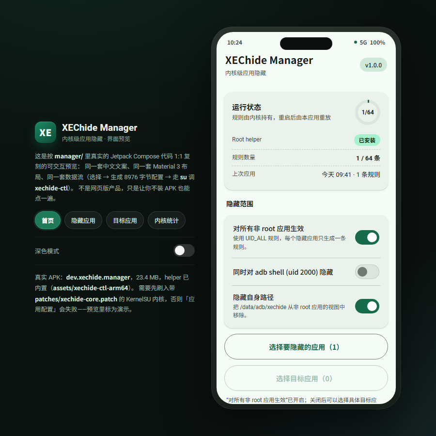
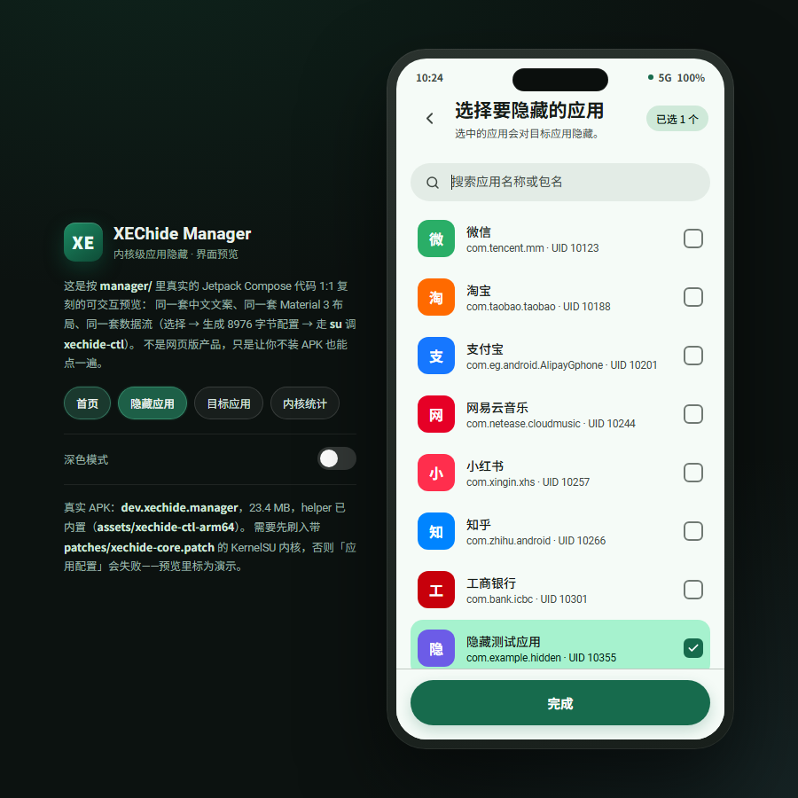
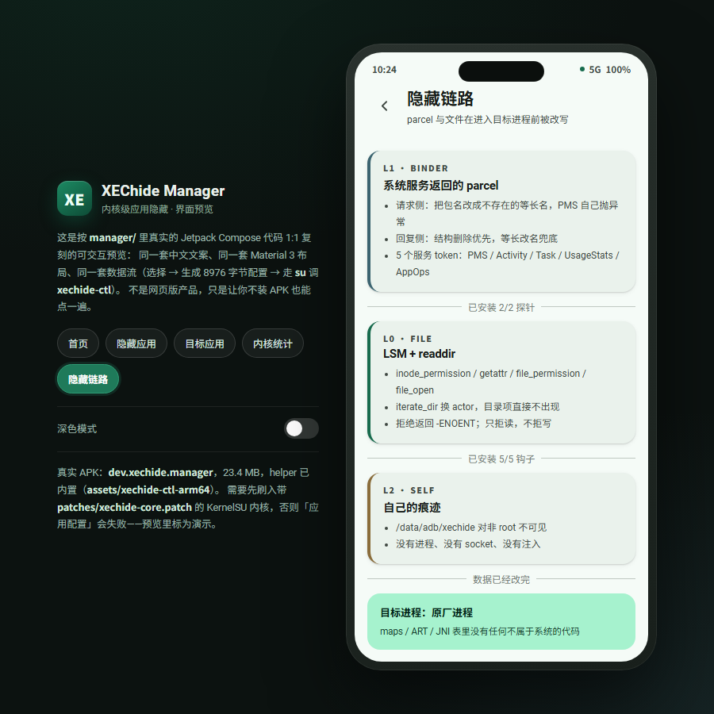

# ui/ — manager preview





`index.html` is a **single-file, interactive preview** of the real manager app
(`manager/`, Jetpack Compose). It mirrors the five screens one-to-one - same
Chinese strings from `strings.xml`, same Material 3 structure, same data flow
(select apps -> build the 8976-byte config -> `su` -> `xechide-ctl set`) - so the
UI can be reviewed without installing the APK or flashing a kernel.

It is **not** a web version of the product: the preview cannot talk to a device,
"应用配置" only simulates the round trip, and the numbers are demo data.

```
python3 -m http.server 8902 --bind 127.0.0.1 --directory ui
# then open http://127.0.0.1:8902/
```

What to look at:

- **首页** - status card (helper state, rule count / 64, last apply), the three
  scope toggles, the two pickers, apply / install / stats.
- **隐藏应用 / 目标应用** - searchable list with UID and per-app selection.
- **内核统计** - the exact `xechide-ctl stats` output shape, with the meaning of
  `parcel_rebuilt` vs `parcel_rewritten`.
- **隐藏链路** - the L1/L0/L2 diagram: where the data is rewritten before the
  target's process ever sees it, and what the hook counts mean.

The panel on the left switches screens and toggles dark mode; the device frame
is a plain phone-width container, nothing more.
